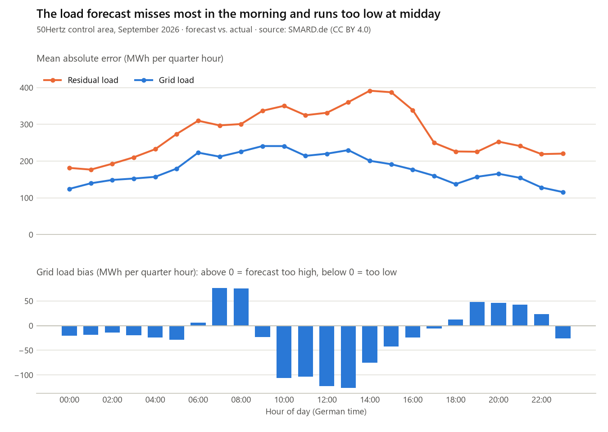

# SMARD Load Forecast Pipeline

A data engineering pipeline for German electricity consumption data from [SMARD](https://www.smard.de).

## Why this project
Grid operators like 50Hertz plan grid operation with load forecasts. When a forecast is wrong, they must react at short notice.
This project compares forecasted and actual grid load in the 50Hertz control area, and shows when the forecast errors are largest.
## Data

- Actual and forecasted consumption from SMARD
- 50Hertz control area, 15-minute resolution
- CSV, json and XML files

## Tools

All tools are free and run locally with Docker.

| Tool | Used for |
| --- | --- |
| Python (pandas) | reading and cleaning the files |
| Docker, Docker Compose | running everything in containers |
| PostgreSQL | storing the data |
| Apache Airflow | running the pipeline automatically |
| dbt Core | transforming and testing the data with SQL |
| Streamlit | dashboard |

## Steps

- Download SMARD data
- Read the CSV, json and XML files with Python
- Load the data into PostgreSQL with Docker
- Automate the pipeline with Airflow
- Transform and test the data with dbt
- Build a dashboard with Streamlit

## Results

In September 2026, the 50Hertz load forecast was most accurate at night (about 5 % WAPE)
and systematically too low around midday (about −120 MWh per quarter hour, ≈ 480 MW).
The residual load forecast misses more, because it also contains wind and solar forecast errors.
## Data source

Bundesnetzagentur | SMARD.de, licensed under [CC BY 4.0](https://creativecommons.org/licenses/by/4.0/).
